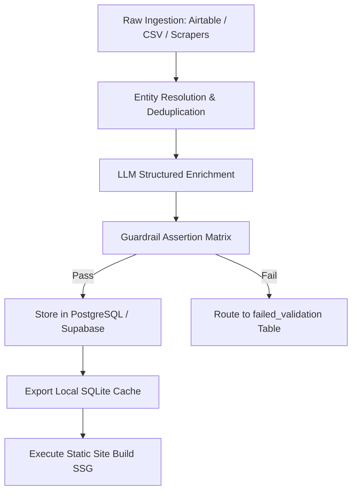

# Module 2: Data Pipeline Blueprints, Schemas & AI Enrichment Workflows

Scaling a programmatic SEO (pSEO) engine to 100,000+ organic monthly visits requires treating data not as content to be written, but as software state to be ingested, normalized, enriched, and validated. If your underlying data pipeline produces duplicate slugs, hallucinated specifications, or low-information-density boilerplate, search engines will classify the entire subfolder as algorithmic spam.

This module provides the production database architectures, ingestion scripts, LLM enrichment engines, and deterministic validation guardrails required to run resilient pSEO operations.

---

## 1. Production Database Schemas

A programmatic SEO database must solve four structural problems:
1. **Slug Stability & Canonical Integrity:** Prevent URL churn and handle parent-child hierarchy.
2. **Dynamic JSON-LD Generation:** Store strongly typed structured data to render schema markup at build time.
3. **Publishing State Machine:** Prevent draft, partially enriched, or soft-deleted pages from hitting the sitemap.
4. **Full-Text & Vector Search:** Support cross-linking related pages based on topical proximity.

### 1.1. PostgreSQL / Supabase Schema

This production DDL includes custom enums, auto-updating timestamps, generated columns for full-text search, and relational constraints between parent hubs and leaf pages.

```sql
-- Enable necessary extensions
CREATE EXTENSION IF NOT EXISTS "uuid-ossp";
CREATE EXTENSION IF NOT EXISTS "pg_trgm";

-- Enum for indexing state management
CREATE TYPE indexing_status AS ENUM (
    'draft',
    'enriched',
    'validated',
    'published',
    'pruned',
    'failed_validation'
);

-- Core Entity Table (The single source of truth for programmatic records)
CREATE TABLE pseo_entities (
    id UUID PRIMARY KEY DEFAULT uuid_generate_v4(),
    slug VARCHAR(255) NOT NULL,
    parent_slug VARCHAR(255),
    entity_type VARCHAR(64) NOT NULL, -- e.g., 'comparison', 'integration', 'city_service'
    primary_keyword VARCHAR(255) NOT NULL,
    canonical_url VARCHAR(512) NOT NULL,
    status indexing_status NOT NULL DEFAULT 'draft',
    
    -- Content payloads
    meta_title VARCHAR(120) NOT NULL,
    meta_description VARCHAR(200) NOT NULL,
    h1 VARCHAR(255) NOT NULL,
    core_attributes JSONB NOT NULL DEFAULT '{}'::jsonb,
    enriched_content JSONB NOT NULL DEFAULT '{}'::jsonb,
    schema_markup JSONB NOT NULL DEFAULT '{}'::jsonb,
    
    -- Quality & Deduplication
    content_hash CHAR(64) NOT NULL, -- SHA-256 hash of normalized core attributes
    quality_score NUMERIC(3, 2) DEFAULT 0.00 CHECK (quality_score >= 0.00 AND quality_score <= 1.00),
    word_count INT NOT NULL DEFAULT 0,
    
    -- Search & Indexing vectors
    tsv_search TSVECTOR GENERATED ALWAYS AS (
        to_tsvector('english', coalesce(primary_keyword, '') || ' ' || coalesce(h1, '') || ' ' || coalesce(meta_description, ''))
    ) STORED,
    
    -- Audit Timestamps
    created_at TIMESTAMPTZ NOT NULL DEFAULT TIMEZONE('utc', NOW()),
    updated_at TIMESTAMPTZ NOT NULL DEFAULT TIMEZONE('utc', NOW()),
    published_at TIMESTAMPTZ,
    
    -- Constraints
    CONSTRAINT uq_pseo_entities_slug UNIQUE (slug),
    CONSTRAINT uq_pseo_entities_hash UNIQUE (content_hash)
);

-- Indexes for maximum query velocity during static generation (SSG)
CREATE INDEX idx_pseo_entities_status_type ON pseo_entities (status, entity_type);
CREATE INDEX idx_pseo_entities_parent_slug ON pseo_entities (parent_slug) WHERE parent_slug IS NOT NULL;
CREATE INDEX idx_pseo_entities_attributes_gin ON pseo_entities USING GIN (core_attributes);
CREATE INDEX idx_pseo_entities_tsv ON pseo_entities USING GIN (tsv_search);
CREATE INDEX idx_pseo_entities_trgm ON pseo_entities USING GIN (primary_keyword gin_trgm_ops);

-- Automatic updated_at trigger function
CREATE OR REPLACE FUNCTION update_timestamp_column()
RETURNS TRIGGER AS $$
BEGIN
    NEW.updated_at = TIMEZONE('utc', NOW());
    RETURN NEW;
END;
$$ language 'plpgsql';

CREATE TRIGGER tr_pseo_entities_updated_at
    BEFORE UPDATE ON pseo_entities
    FOR EACH ROW
    EXECUTE FUNCTION update_timestamp_column();
```

### 1.2. SQLite Schema (Optimized for SSG Build Caches)

For Next.js, Astro, or Eleventy builds running on local runners, reading from a pre-built SQLite file is up to 10x faster than remote API fetches.

```sql
PRAGMA journal_mode = WAL;
PRAGMA synchronous = NORMAL;
PRAGMA foreign_keys = ON;

CREATE TABLE IF NOT EXISTS programmatic_pages (
    id TEXT PRIMARY KEY,
    slug TEXT NOT NULL UNIQUE,
    parent_slug TEXT,
    entity_type TEXT NOT NULL,
    primary_keyword TEXT NOT NULL,
    canonical_url TEXT NOT NULL,
    status TEXT CHECK(status IN ('draft', 'enriched', 'validated', 'published', 'pruned')) NOT NULL DEFAULT 'draft',
    meta_title TEXT NOT NULL,
    meta_description TEXT NOT NULL,
    h1 TEXT NOT NULL,
    data_json TEXT NOT NULL, -- Encoded JSON object for template bindings
    schema_json TEXT NOT NULL, -- Pre-computed Schema.org JSON-LD
    content_hash TEXT NOT NULL UNIQUE,
    word_count INTEGER NOT NULL,
    published_at TEXT,
    updated_at TEXT NOT NULL DEFAULT (strftime('%Y-%m-%d %H:%M:%SZ', 'now'))
);

CREATE INDEX IF NOT EXISTS idx_pages_status_type ON programmatic_pages(status, entity_type);
CREATE INDEX IF NOT EXISTS idx_pages_parent ON programmatic_pages(parent_slug);
```

---

## 2. Airtable-to-JSON Pipeline with Incremental Sync

Airtable is often used as a non-technical curation interface. However, querying the Airtable API directly during a production site build introduces severe rate limits (5 requests per second) and leads to broken deployments.

This Node.js script provides an incremental sync: it fetches records, computes an MD5 checksum of each row, checks against a local cache, and writes only modified records to static JSON outputs.

Save this as `scripts/airtable-sync.ts`:

```typescript
import fs from "node:fs/promises";
import path from "node:path";
import crypto from "node:crypto";

interface AirtableRawRecord {
  id: string;
  fields: {
    Slug?: string;
    EntityType?: string;
    PrimaryKeyword?: string;
    ParentSlug?: string;
    MetaTitle?: string;
    MetaDescription?: string;
    H1?: string;
    AttributesJSON?: string;
    Published?: boolean;
  };
}

interface NormalizedPageRecord {
  id: string;
  slug: string;
  parentSlug: string | null;
  entityType: string;
  primaryKeyword: string;
  metaTitle: string;
  metaDescription: string;
  h1: string;
  attributes: Record<string, unknown>;
  contentHash: string;
  lastSyncedAt: string;
}

interface SyncManifest {
  lastSyncTimestamp: string;
  recordHashes: Record<string, string>;
}

const AIRTABLE_API_KEY = process.env.AIRTABLE_API_KEY!;
const AIRTABLE_BASE_ID = process.env.AIRTABLE_BASE_ID!;
const AIRTABLE_TABLE_NAME = process.env.AIRTABLE_TABLE_NAME || "ProgrammaticPages";
const OUTPUT_DIR = path.resolve(process.cwd(), "data/generated");
const MANIFEST_PATH = path.resolve(OUTPUT_DIR, ".sync-manifest.json");

function computeHash(payload: unknown): string {
  return crypto
    .createHash("sha256")
    .update(JSON.stringify(payload))
    .digest("hex");
}

async function loadManifest(): Promise<SyncManifest> {
  try {
    const raw = await fs.readFile(MANIFEST_PATH, "utf-8");
    return JSON.parse(raw);
  } catch {
    return { lastSyncTimestamp: new Date(0).toISOString(), recordHashes: {} };
  }
}

async function fetchAirtablePage(offset?: string): Promise<{ records: AirtableRawRecord[]; offset?: string }> {
  const url = new URL(`https://api.airtable.com/v0/${AIRTABLE_BASE_ID}/${AIRTABLE_TABLE_NAME}`);
  url.searchParams.append("view", "Grid view");
  url.searchParams.append("pageSize", "100");
  if (offset) {
    url.searchParams.append("offset", offset);
  }

  const response = await fetch(url.toString(), {
    headers: {
      Authorization: `Bearer ${AIRTABLE_API_KEY}`,
      "Content-Type": "application/json",
    },
  });

  if (!response.ok) {
    throw new Error(`Airtable sync failed: ${response.status} ${response.statusText}`);
  }

  return response.json();
}

async function runPipeline(): Promise<void> {
  if (!AIRTABLE_API_KEY || !AIRTABLE_BASE_ID) {
    throw new Error("Missing AIRTABLE_API_KEY or AIRTABLE_BASE_ID environment variables.");
  }

  await fs.mkdir(OUTPUT_DIR, { recursive: true });
  const manifest = await loadManifest();
  const nextManifest: SyncManifest = {
    lastSyncTimestamp: new Date().toISOString(),
    recordHashes: { ...manifest.recordHashes },
  };

  let offset: string | undefined = undefined;
  let totalProcessed = 0;
  let totalUpdated = 0;

  console.log("Starting Airtable incremental synchronization...");

  do {
    const data = await fetchAirtablePage(offset);
    offset = data.offset;

    for (const record of data.records) {
      totalProcessed++;
      const fields = record.fields;

      // Filter non-published records immediately
      if (!fields.Published || !fields.Slug) {
        continue;
      }

      let parsedAttributes = {};
      try {
        parsedAttributes = fields.AttributesJSON ? JSON.parse(fields.AttributesJSON) : {};
      } catch {
        console.warn(`[WARN] Invalid JSON in record ${record.id} (${fields.Slug}). Defaulting to empty object.`);
      }

      const normalized: NormalizedPageRecord = {
        id: record.id,
        slug: fields.Slug.trim().toLowerCase(),
        parentSlug: fields.ParentSlug ? fields.ParentSlug.trim().toLowerCase() : null,
        entityType: fields.EntityType || "general",
        primaryKeyword: fields.PrimaryKeyword || "",
        metaTitle: fields.MetaTitle || "",
        metaDescription: fields.MetaDescription || "",
        h1: fields.H1 || "",
        attributes: parsedAttributes,
        contentHash: "",
        lastSyncedAt: nextManifest.lastSyncTimestamp,
      };

      const recordHash = computeHash(normalized);
      normalized.contentHash = recordHash;

      // Incremental cache check
      if (manifest.recordHashes[record.id] === recordHash) {
        continue;
      }

      // Write single page JSON data
      const targetFilePath = path.join(OUTPUT_DIR, `${normalized.slug}.json`);
      await fs.writeFile(targetFilePath, JSON.stringify(normalized, null, 2), "utf-8");

      nextManifest.recordHashes[record.id] = recordHash;
      totalUpdated++;
    }
  } while (offset);

  // Write updated manifest
  await fs.writeFile(MANIFEST_PATH, JSON.stringify(nextManifest, null, 2), "utf-8");

  console.log(`Sync complete. Processed: ${totalProcessed}. Written to disk: ${totalUpdated}.`);
}

runPipeline().catch((err) => {
  console.error("Pipeline run failed:", err);
  process.exit(1);
});
```

---

## 3. LLM Enrichment Engine with Structured Outputs

Raw source data is rarely ready to publish immediately. It requires contextual analysis, concise synthesis, and structural transformations (e.g., pros/cons, unique pricing verdict, programmatic FAQ answers).

The enrichment pipeline below uses Python, Pydantic, and OpenAI’s native JSON Schema Structured Outputs API to eliminate formatting errors entirely.

Save this as `pipelines/enrichment_engine.py`:

```python
import os
import json
import logging
from typing import List, Optional
from pydantic import BaseModel, Field
from openai import OpenAI

logging.basicConfig(level=logging.INFO, format="%(asctime)s [%(levelname)s] %(message)s")
logger = logging.getLogger(__name__)

# Pydantic Schema for Strict Output Enforcement
class FAQItem(BaseModel):
    question: str = Field(description="Search-intent focused question containing entity name")
    answer: str = Field(description="Direct, factual answer under 45 words. No filler phrases.")

class ComparisonInsight(BaseModel):
    feature_name: str
    winner_entity_name: str
    nuance_explanation: str = Field(description="One sentence detailing specific trade-offs.")

class PageEnrichmentPayload(BaseModel):
    h2_verdict: str = Field(description="Authoritative, 1-sentence verdict on which option is best for whom.")
    key_tradeoffs: List[str] = Field(description="3 distinct non-obvious operational or technical trade-offs.")
    comparison_breakdown: List[ComparisonInsight]
    faqs: List[FAQItem] = Field(description="3 programmatic FAQ objects matching long-tail search intent.")
    schema_faq_type: str = Field(default="FAQPage")

SYSTEM_PROMPT = """You are a senior programmatic content strategist and technical data analyst.
Your task is to analyze raw entity data and produce dense, factual comparisons for search engines.

STRICT EDITORIAL RULES:
1. Ban these words completely: 'delve', 'testament', 'tapestry', 'game-changer', 'revolutionize', 'paramount', 'moreover'.
2. Zero marketing fluff. Every sentence must communicate a metric, a specific feature, a constraint, or an integration fact.
3. Every FAQ answer must start with a direct conclusion, not an introductory dependent clause.
4. Do not invent pricing, certifications, or feature support not directly present in the source data.
"""

def enrich_entity_record(client: OpenAI, entity_a_name: str, entity_b_name: str, raw_attributes: dict) -> PageEnrichmentPayload:
    user_prompt = f"""Generate analytical comparison content for the following two entities:
Entity A: {entity_a_name}
Entity B: {entity_b_name}

Source Data:
{json.dumps(raw_attributes, indent=2)}

Extract non-obvious distinctions and format directly into the requested JSON schema."""

    try:
        completion = client.beta.chat.completions.parse(
            model="gpt-4o-mini-2024-07-18",
            messages=[
                {"role": "system", "content": SYSTEM_PROMPT},
                {"role": "user", "content": user_prompt},
            ],
            response_format=PageEnrichmentPayload,
            temperature=0.2, # Low temperature ensures strict factual consistency
        )
        return completion.choices[0].message.parsed
    except Exception as e:
        logger.error(f"Enrichment failed for {entity_a_name} vs {entity_b_name}: {str(e)}")
        raise

if __name__ == "__main__":
    api_key = os.getenv("OPENAI_API_KEY")
    if not api_key:
        raise ValueError("OPENAI_API_KEY environment variable not set.")
        
    ai_client = OpenAI(api_key=api_key)

    mock_raw_data = {
        "entity_a": {
            "name": "PostgreSQL",
            "type": "Relational DBMS",
            "pricing_model": "Open Source",
            "memory_engine": "Buffer Pool",
            "json_support": "Native JSONB indexing",
            "replication": "Streaming Replication"
        },
        "entity_b": {
            "name": "MongoDB",
            "type": "Document Store",
            "pricing_model": "Source Available (SSPL)",
            "memory_engine": "WiredTiger",
            "json_support": "Native BSON",
            "replication": "Replica Sets"
        }
    }

    result = enrich_entity_record(
        client=ai_client,
        entity_a_name="PostgreSQL",
        entity_b_name="MongoDB",
        raw_attributes=mock_raw_data
    )

    print(json.dumps(result.model_dump(), indent=2))
```

---

## 4. Automated Deduplication & Entity Resolution Engine

Programmatic databases frequently ingest the same physical entity from multiple upstream files, CSVs, or scrapers under differing names (e.g., `Stripe, Inc.` vs. `Stripe`, or `San Francisco, CA` vs. `San Francisco, California`). 

Allowing multiple variants generates cannibalizing URLs and triggers duplicate content penalties.

The engine below implements deterministic entity resolution using text normalization, token-sort similarity, and canonical slug assignment.

Save this as `pipelines/entity_resolution.py`:

```python
import re
import unicodedata
from typing import Dict, List, Tuple

class EntityResolver:
    def __init__(self, similarity_threshold: float = 0.88):
        self.threshold = similarity_threshold
        # Stop-words that distort entity matching
        self.corporate_suffixes = {
            "inc", "incorporated", "corp", "corporation", 
            "llc", "ltd", "limited", "co", "company"
        }

    def normalize_text(self, text: str) -> str:
        text = unicodedata.normalize("NFKD", text).encode("ascii", "ignore").decode("utf-8")
        text = text.lower().strip()
        # Remove all punctuation
        text = re.sub(r"[^\w\s]", "", text)
        tokens = text.split()
        cleaned_tokens = [t for t in tokens if t not in self.corporate_suffixes]
        return " ".join(cleaned_tokens)

    def generate_slug(self, text: str) -> str:
        normalized = self.normalize_text(text)
        slug = re.sub(r"\s+", "-", normalized)
        return slug

    def _levenshtein_distance(self, s1: str, s2: str) -> int:
        if len(s1) < len(s2):
            return self._levenshtein_distance(s2, s1)
        if len(s2) == 0:
            return len(s1)

        previous_row = range(len(s2) + 1)
        for i, c1 in enumerate(s1):
            current_row = [i + 1]
            for j, c2 in enumerate(s2):
                insertions = previous_row[j + 1] + 1
                deletions = current_row[j] + 1
                substitutions = previous_row[j] + (c1 != c2)
                current_row.append(min(insertions, deletions, substitutions))
            previous_row = current_row
        return previous_row[-1]

    def token_sort_ratio(self, str1: str, str2: str) -> float:
        norm1 = " ".join(sorted(self.normalize_text(str1).split()))
        norm2 = " ".join(sorted(self.normalize_text(str2).split()))
        
        if not norm1 and not norm2:
            return 1.0
        if not norm1 or not norm2:
            return 0.0

        distance = self._levenshtein_distance(norm1, norm2)
        max_len = max(len(norm1), len(norm2))
        return 1.0 - (distance / max_len)

    def resolve_entities(self, raw_entities: List[Dict]) -> List[Dict]:
        """
        Groups similar entities and merges secondary records into the canonical record.
        """
        canonical_pool: List[Dict] = []

        for candidate in raw_entities:
            candidate_name = candidate["name"]
            best_match: Tuple[Optional[Dict], float] = (None, 0.0)

            for canonical in canonical_pool:
                score = self.token_sort_ratio(candidate_name, canonical["canonical_name"])
                if score > best_match[1]:
                    best_match = (canonical, score)

            if best_match[1] >= self.threshold and best_match[0] is not None:
                # Merge into existing canonical record
                target = best_match[0]
                target["aliases"].append(candidate_name)
                # Merge attributes: fill nulls
                for k, v in candidate.get("attributes", {}).items():
                    if k not in target["attributes"] or target["attributes"][k] is None:
                        target["attributes"][k] = v
            else:
                # Create a new canonical record
                canonical_record = {
                    "canonical_id": f"ent_{self.generate_slug(candidate_name)}",
                    "canonical_name": candidate_name,
                    "canonical_slug": self.generate_slug(candidate_name),
                    "aliases": [candidate_name],
                    "attributes": candidate.get("attributes", {})
                }
                canonical_pool.append(canonical_record)

        return canonical_pool

if __name__ == "__main__":
    sample_inputs = [
        {"name": "Stripe, Inc.", "attributes": {"pricing": "2.9% + 30c", "hq": "San Francisco"}},
        {"name": "Stripe", "attributes": {"developer_api": "REST", "hq": None}},
        {"name": "Adyen N.V.", "attributes": {"pricing": "Interchange++", "hq": "Amsterdam"}},
        {"name": "Adyen", "attributes": {"developer_api": "GraphQL", "hq": "Amsterdam"}},
        {"name": "Stripe Payment Processing LLC", "attributes": {"founded": 2010}},
    ]

    resolver = EntityResolver(similarity_threshold=0.85)
    resolved = resolver.resolve_entities(sample_inputs)

    import json
    print(json.dumps(resolved, indent=2))
```

---

## 5. Automated Fact-Checking & Guardrail Matrix

A pSEO engine cannot rely on manual QA across 10,000+ pages. Every generated row must pass a programmatic assertion matrix before entering the production database. If a row violates a single rule, it is routed to `'failed_validation'` and excluded from deployments.

### Guardrail Specification Matrix

| Metric | Target Boundary | Severity | Triggered Action |
| :--- | :--- | :--- | :--- |
| **Meta Title Length** | 30 to 60 characters | Critical | Flag & fallback to template default |
| **Meta Description Length** | 110 to 155 characters | Critical | Flag & fallback to template default |
| **Banned AI Vocabulary** | Count = 0 matches | High | Reject row; trigger deterministic rewrite |
| **Attribute Density** | Minimum 4 non-null attributes | Critical | Prune page (Thin Content protection) |
| **Internal Canonical URL** | Must match regex `/^[a-z0-9-\/]+$/` | Blocker | Abort build immediately |
| **Numerical Bounds** | `0 <= price <= 1,000,000` | High | Revert field to `Contact Sales` |

Save this validation harness as `pipelines/guardrails.py`:

```python
import re
from typing import Dict, Any, List, Tuple

class QualityGuardrailEngine:
    BANNED_WORDS = {
        "delve", "testament", "tapestry", "revolutionize", 
        "game-changer", "paramount", "nestled", "unleash",
        "beacon", "foster", "holistic", "seamlessly"
    }

    def __init__(self):
        self.slug_regex = re.compile(r"^[a-z0-9]+(?:-[a-z0-9]+)*$")

    def validate_page(self, page_data: Dict[str, Any]) -> Tuple[bool, List[str]]:
        errors: List[str] = []

        # 1. Title Validation
        meta_title = page_data.get("meta_title", "")
        if not (30 <= len(meta_title) <= 65):
            errors.append(f"Meta title length out of bounds ({len(meta_title)} chars). Must be 30-65.")

        # 2. Description Validation
        meta_desc = page_data.get("meta_description", "")
        if not (110 <= len(meta_desc) <= 160):
            errors.append(f"Meta description length out of bounds ({len(meta_desc)} chars). Must be 110-160.")

        # 3. Slug Regex Enforcement
        slug = page_data.get("slug", "")
        if not self.slug_regex.match(slug):
            errors.append(f"Slug '{slug}' contains invalid characters, uppercase letters, or consecutive dashes.")

        # 4. Thin Content Guardrail
        attributes = page_data.get("attributes", {})
        non_null_attrs = [k for k, v in attributes.items() if v is not None and str(v).strip() != ""]
        if len(non_null_attrs) < 4:
            errors.append(f"Thin content failure: Only {len(non_null_attrs)} valid attributes present. Minimum is 4.")

        # 5. Hallucination / AI Vocabulary Scan
        all_text = " ".join([
            meta_title,
            meta_desc,
            page_data.get("h1", ""),
            str(page_data.get("enriched_content", ""))
        ]).lower()

        found_banned = [w for w in self.BANNED_WORDS if re.search(r'\b' + re.escape(w) + r'\b', all_text)]
        if found_banned:
            errors.append(f"Banned AI vocabulary detected: {', '.join(found_banned)}")

        # 6. Structured Schema Validation
        schema = page_data.get("schema_markup", {})
        if not schema.get("@context") or not schema.get("@type"):
            errors.append("Invalid or missing Schema.org JSON-LD root fields (@context or @type missing).")

        is_valid = len(errors) == 0
        return is_valid, errors

if __name__ == "__main__":
    guardrail = QualityGuardrailEngine()

    dirty_mock_page = {
        "slug": "stripe-vs-paypal-2024!",
        "meta_title": "Stripe vs PayPal: Which Is The Best?",
        "meta_description": "We delve into the paramount tapestry of digital payments to revolutionize your checkout experience today.",
        "h1": "Stripe vs PayPal Comparison",
        "attributes": {
            "fee": "2.9%",
            "chargeback_protection": None,
            "api_type": ""
        },
        "enriched_content": "This payment processor is a game-changer.",
        "schema_markup": {}
    }

    passed, failures = guardrail.validate_page(dirty_mock_page)
    print(f"Validation Passed: {passed}")
    for fail in failures:
        print(f" - FAIL: {fail}")
```

---

## 6. Pipeline Execution Runbook & Pre-Flight Checklist

Before initiating static generation builds or publishing database records to production, run this operational sequence in order.



### Pre-Flight Verification Checklist

- [ ] **Database Connection Pool Sizing:** Ensure your PostgreSQL connection pool supports at least $N$ parallel workers: $\text{Max Connections} \ge (\text{Worker Threads} \times 2) + 5$.
- [ ] **Slug Stability Check:** Confirm that no previously generated slug has changed its path prefix, which would introduce 404s without automated 301 redirects.
- [ ] **Index Freshness Verification:** Run `ANALYZE pseo_entities;` in PostgreSQL to update planner statistics for `tsv_search` and trgm indexes before running dynamic routing queries.
- [ ] **OpenAI Schema Locking:** Verify that the enrichment script uses `response_format=PydanticModel` with `temperature` set to `0.2` or lower to prevent structural divergence.
- [ ] **Zero Banned Words:** Verify that `pipelines/guardrails.py` returns `exit code 0` on sample outputs prior to running batch updates.
- [ ] **Differential Build Artifacts:** Check `.
